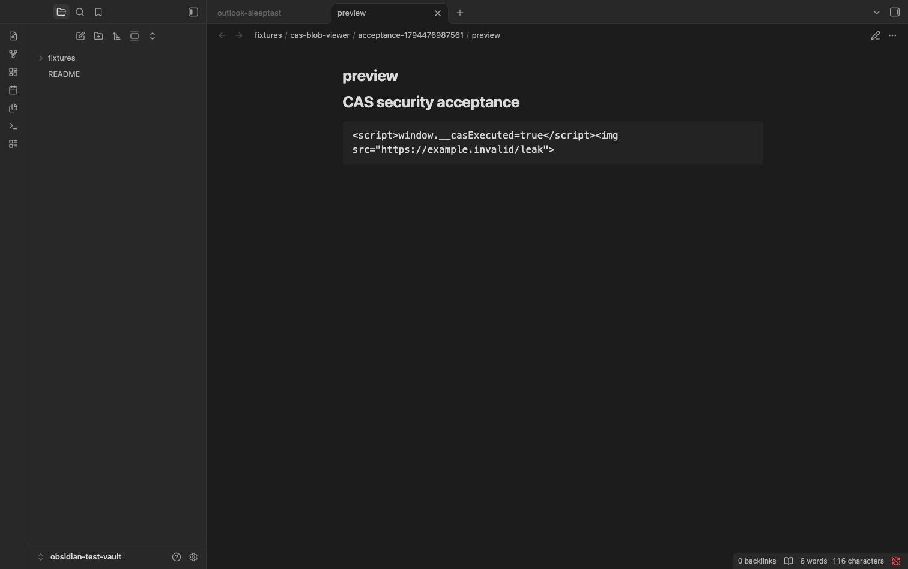

# Release validation — 0.1.6

The clean Community candidate contains the plugin, build/lint configuration, synthetic tests and public documentation. Runtime dependencies on Obsidian/CodeMirror are external and supplied by the host. No private vault helper or history is part of this repository.

Local checks: clean `npm ci`, TypeScript, official `eslint-plugin-obsidianmd` with no warnings, unit parsing/path tests, built-plugin security/lifecycle regressions, production build and Community preflight. The synthetic runtime harness executes the actual bundled entrypoint, rather than mirroring its implementation.

[Actual-host report](evidence/runtime-0.1.6-macos.json): 21 checks pass in Obsidian 1.15.0 (installer 1.12.7), macOS Apple Silicon. Covers inert HTML, absence of active markup/script execution, preserved source bytes, PNG rendering, empty/missing/oversized content, traversal rejection, wiki toggle, six searchable settings and six legacy controls, real preview note, cooperating plugin state and exact settings/active-note restoration. A real rendered synthetic HTML preview is shown below. No real vault content is used.



For another local host run, use the marked isolated standard test vault and a new report destination:

```sh
npm run test:host -- /absolute/path/to/obsidian-test-vault /absolute/local/path/new-report.json
```

The host runner assumes the candidate is already installed and loaded. It creates its own unique fixtures, restores the exact settings bytes and active note, and leaves fixtures as inspectable evidence. It never installs to or tests a main user vault.

Boundaries: exact minimum-version execution, mobile devices, PDF viewer interaction and experimental Live Preview are not established by this host report. The API minimum is retained after source/lint assessment; these tests do not turn that into actual host evidence. The content-addressed filename is not rehashed by the plugin. File size is checked before and after reading; the adapter API returns a complete buffer, so concurrent growth cannot be prevented from allocating before the second check.

The exact-source official preview and full release review are Completed for commit `f34cc596b7aeea16243f54027d85892d61417759`. Network, vault-read behavior, dependencies, obfuscation and build verification are Pass. Obsidian reproduced the released main.js byte-for-byte. All three anonymous release downloads match the tested files, and the public Community listing displays 0.1.6.

Fresh app-catalog installation is the one pending check: the newly published ID was not yet in official community-plugins.json, and the CLI install produced no installed plugin. The verified manual release installation was restored and passed all 21 actual-host checks again. This does not count as a successful catalog installation. Obsidian documents up to 24 hours of propagation for new approved projects. Recheck after 13 November 2026 at 12:00 Europe/Amsterdam; no automatic recheck is scheduled. See [publication readback](evidence/publication-0.1.6.json) and issue #1.
